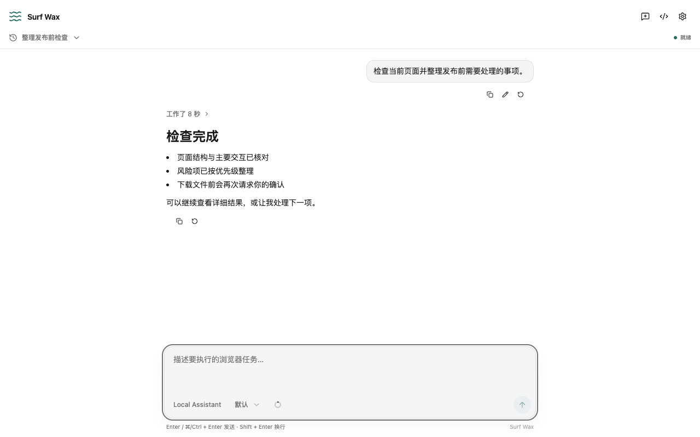

# Surf Wax

[](package.json)
[](https://www.google.com/chrome/)

Surf Wax 是一个运行在 Chrome Side Panel 中的浏览器智能体。它让你使用自己的模型和 API 凭据，通过自然语言读取页面、填写表单、管理标签页、处理文件，并组合执行复杂的浏览器任务。



## 为什么使用 Surf Wax

- **自选模型（BYOK）**：Provider 和模型目录来自 [Models.dev](https://models.dev/)，也支持自定义 Model ID、Base URL 和协议。
- **直接连接模型服务**：没有开发者运营的模型中转、遥测或同步服务；配置、凭据和会话记录保存在本机。
- **可组合浏览器自动化**：智能体通过 `inspect`、`run` 和 `jobs` 读取页面、跨窗口管理标签页、执行 JavaScript 工作流并管理后台任务，而不是受固定步骤数限制。
- **适合长任务**：追加式 canonical event log 统一保存对话、工具结果、错误、中断状态和产物；上下文不足时自动压缩。
- **完整 Side Panel 体验**：支持流式输出、GFM、LaTeX、代码高亮、会话搜索、分支和重试，以及浅色和深色主题。
- **安全的交互边界**：智能体操作页面时会显示防干扰层；工具无论成功、失败或中断都会留下结果记录。
- **持久用户脚本**：可创建、编辑、启停并在扩展启动或升级后恢复 `chrome.userScripts` 脚本。

## 安装

### Chrome Web Store

从 [Chrome Web Store](https://chromewebstore.google.com/detail/surf-wax/kkopacjlnfpnpmfeinomkhhcndbdeoih) 安装 Surf Wax。需要 Chrome 138 或更高版本；商店当前公开版本可能晚于仓库中的未发布源码。

### 手动安装发布包

1. 正式版本发布后，从 [Releases](https://github.com/notCorwin/SurfWax/releases) 下载版本 ZIP，并使用同版本的 `.sha256` 文件校验完整性。若页面尚无 Release，请勿使用来源不明的安装包。
2. 解压 ZIP。
3. 打开 `chrome://extensions`，启用“开发者模式”。
4. 选择“加载已解压的扩展程序”，然后选择解压目录。

手动安装的版本不会通过 Chrome Web Store 自动更新。升级时应在原目录中替换文件并从扩展管理页重新加载；把新版本解压到另一个路径后重新安装可能产生新的扩展 ID，原本地配置与会话不会自动迁移。

## 开始使用

1. 点击 Surf Wax 扩展图标，打开 Side Panel。
2. 打开设置，选择一个 Provider，并填写所需凭据；免鉴权的自定义 Endpoint 可将 API Key 留空。
3. 选择或输入 Model ID，然后保存。
4. 打开目标网页，在 Side Panel 中描述任务，例如：

   ```text
   阅读这个页面，提取产品名称和价格，并整理成 Markdown 表格。
   ```

   ```text
   填写注册表单，但提交前停下来让我确认。
   ```

如果使用用户脚本，请先在扩展详情页启用 **Allow User Scripts**。高级设置中可以覆盖 Context Window、`max_tokens`、图片输入能力、Base URL 和端点协议。自定义端点支持：

- OpenAI Chat Completions、Completions 和 Responses
- Anthropic Messages
- Google `generateContent` 和 Interactions

未知模型的 Context Window 默认按 256,000 tokens 处理；除 Anthropic 类端点外，Surf Wax 不会主动传递未知的 `max_tokens`。远程 HTTP Endpoint 会在界面中持续警告，因为凭据和任务内容没有 HTTPS 传输保护。

## 数据与权限

模型配置和凭据存储在 `chrome.storage.local`，会话和工具事件存储在本机 IndexedDB。任务所需的消息、网页内容、截图或工具结果会直接发送到你配置的模型服务，不会经过 Surf Wax 开发者服务器。删除单个会话会写入可撤销 tombstone；设置页的“永久清空”会物理删除全部 IndexedDB 会话、事件和内部产物。

扩展需要 `debugger`、`downloads`、`scripting`、`sidePanel`、`storage`、`tabs`、`unlimitedStorage`、`userScripts` 和 `<all_urls>`，用于浏览器控制、文件保存、防干扰层、本地记录、用户脚本和连接自定义模型端点。智能体生成的文件默认只保存在内部日志，每次写入 Chrome 下载目录前仍需用户在 Side Panel 确认。允许扩展进入隐身窗口时，任务内容仍写入扩展的持久本地日志。完整规则见 [隐私政策](PRIVACY.md)。

## 本地开发

### 环境要求

- Node.js 24
- npm
- Chrome 138+（日常使用）
- Playwright Chromium（开发环境）

安装依赖和开发浏览器：

```sh
npm ci
npx playwright install chromium
```

启动开发环境：

```sh
npm run dev
```

该命令启动 Vite、加载 `dist/` 中的开发扩展、打开一个持久化 Chromium profile，并显示真实 Side Panel。也可以指定启动页面：

```sh
npm run dev -- https://example.com
```

界面代码支持 HMR；后台脚本或 Manifest 变化会重新加载扩展。开发 profile 保存在仓库相邻的 `../.dev/chromium-profile/`。

如需仅构建扩展：

```sh
npm run build
```

构建结果位于 `dist/`，可通过 `chrome://extensions` 加载。

## 验证

常用检查：

```sh
npm run check       # TypeScript、独立构建和产物契约
npm run lint        # Biome 静态正确性检查
npm test            # Vitest 单元测试
npm run test:e2e    # Headless Chrome 功能测试
npm run docs:check  # 检查生成的工具文档是否最新
```

提交前运行完整本地 CI：

```sh
npm run verify:local
```

完整验证要求 Node 24，会安装 Chrome for Testing 138 和当前 Stable，并执行文档、SDK、依赖新鲜度、安全审计、静态检查、类型、构建、单元、E2E 与性能检查。所有浏览器测试均以 Headless 模式运行；发布前还应人工检查真实 Side Panel、下载确认和商店素材。仓库当前不配置 GitHub Actions 或自动发布。

其他维护命令见 [package.json](package.json)。浏览器工具 API 由源码 registry 生成，详见 [工具参考](docs/tools.md)。

## 项目结构

```text
src/
├── agent/        模型路由、流式请求、上下文与智能体协调
├── chrome/       页面检查、浏览器执行、任务和交互防护
├── components/   聊天界面与通用 UI 组件
├── options/      Provider、模型和高级设置
├── sidepanel/    会话运行时、事件投影和 Side Panel
└── userscripts/  用户脚本管理器
e2e/              Chrome 扩展端到端与性能测试
docs/             工具参考、验收记录和商店材料
scripts/          开发、验证、文档生成和发布脚本
```

Surf Wax 是单一 Manifest V3 Chrome Extension，不依赖桌面桥接应用。Side Panel 是主要运行环境；模型调用统一基于 Vercel AI SDK。`src/logging.ts` 中的追加式 canonical event log 是会话和执行记录的唯一权威来源。

## 贡献

提交修改前请先阅读 [AGENTS.md](AGENTS.md)，并遵循以下流程：

1. 从最新的 `master` 创建分支。
2. 保持现有功能完整，并为可观察的行为变化补充核心测试。
3. 更新由变更影响的文档；工具 registry 变化后运行 `npm run docs:tools`。
4. 运行相关测试以及 `npm run verify:local`。
5. 提交 Pull Request，说明用户可见变化和验证结果。

不要提交凭据、浏览器 profile、测试产物或 `dist/`。项目由 [notCorwin](https://github.com/notCorwin) 维护；问题、功能建议和贡献讨论请使用 [GitHub Issues](https://github.com/notCorwin/SurfWax/issues)。提交日志或截图前请先移除私人网页内容和凭据。

## 发布与许可

版本历史见 [CHANGELOG.md](CHANGELOG.md)，安装包见 [GitHub Releases](https://github.com/notCorwin/SurfWax/releases)。源码按 [GNU General Public License v3.0 only](LICENSE) 授权。
