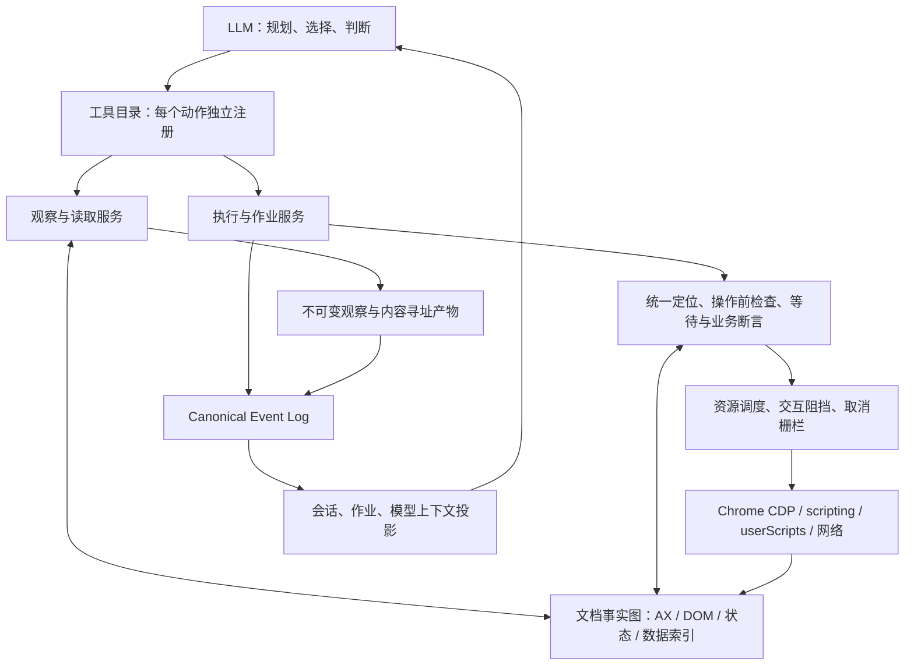

# Surf Wax：世界一流 LLM Browser Tools 技术设计

状态：提案，尚未实现或通过本文验收。修订日期：2026-10-29。实现基线：`54d16cc371dd0375278a3f81b869e066736a9e84`。

本文设计 Surf Wax 下一代浏览器工具内核与模型接口，目标同时满足：大部分具备基础工具调用能力的 LLM 能可靠操作；常见任务的总 Token 成本低；强模型能够完成跨站、多阶段、长时间、数据密集的复杂任务。本文不把工具数量少、单次返回短或某个强模型的演示成功当作目标达成。

## 1. 核心决策

采用**一个明确动作对应一个独立工具，所有工具共享执行内核**。例如 `click`、`fill`、`read_text` 各有自己的名称、输入 schema、回执和管理项；不再用带 `op` 枚举的 `act` 包装常用动作。`execute_program` 是独立的高级组合入口，可在本地编排相同的原子能力，适合循环、条件分支和数据处理。

1. **模型决定意图，内核解决机械问题。** 模型不必编写 JavaScript 才能点击、填表、读取结果；等待、唯一定位、命中检测、回执与结果裁剪由确定性代码完成。
2. **先获取可复用事实，再按任务投影。** 每个文档只有一份受失效机制约束的页面事实图；观察、定位、抽取和验证共同使用，按变化更新，按需输出。
3. **压缩传输，不丢失证据。** 完整数据保存在有来源的产物中；模型读取摘要、相关区域和增量。预算不足、未读取范围和内容失效必须显式表达。
4. **动作完成与业务成功分开。** 已派发但结果未知的写操作不自动重放。业务成功必须有任务对应的可核验证据。
5. **复杂能力按需展开，执行能力不设人工天花板。** 保留 JavaScript、CDP、页面与扩展网络、原生输入、用户脚本等能力，不设置全局智能体步数上限或额外权限审批。
6. **工具可单独管理。** 默认公开全部工具；用户可在高级设置中调整下一次运行的工具目录，运行期间的目录和上下文前缀保持稳定。工具可见性不是权限隔离边界。

“前 1%”在本文中是需要专门验证的复杂任务集合，不是已经证明覆盖真实世界任务分布的统计结论。纯像素且无语义、无可读数据、无视觉模型的任务存在信息边界，工具不能凭空补足视觉或推理能力。

## 2. 已有基础与需要修复的根因

以下为仓库检查结果；后文接口均为提案，不能与当前 [工具参考](tools.md) 混用。

| 领域 | 当前实现与证据 | 设计处理 |
| --- | --- | --- |
| 模型入口 | [tool.ts](../src/chrome/tool.ts) 暴露 `inspect / run / jobs`；常用操作也要写 JavaScript | 替换为按动作独立注册的工具和可选组合程序，复用同一浏览器内核 |
| 页面观察 | [automation.ts](../src/chrome/automation.ts) 的 `captureSnapshot` 每次对各会话抓全量 AX 树；区域选择、差分在之后发生 | 建立按文档/帧管理的事实图与增量采集；输出增量不能冒充采集增量 |
| 定位语义 | 简单 role/label 使用 Chrome AX，组合定位使用手写 DOM 语义；部分路径唯一性检查后再次查询对象 | 统一语义来源；将候选选择绑定到同一节点身份，避免检查和执行之间换对象 |
| 上下文 | [runner.ts](../src/agent/runner.ts) 与 `prepareToolMessages` 临时插入浏览器状态/图片，下一步可能移除 | 将实际发送内容固化为日志驱动、仅追加的模型上下文投影 |
| 目标归属 | [executor.ts](../src/chrome/executor.ts) 在绑定标签失效后可能改选其他 active tab | 绑定目标失效时返回错误，禁止静默切换到无关页面 |
| 执行恢复 | 已有沙箱 Worker、动作回执、取消、输入清理和宿主丢失后的 interrupted | 保留这些正确语义，补充可恢复业务检查点；不恢复任意 JS 调用栈 |
| 长执行 | [program-timeout.ts](../src/chrome/program-timeout.ts) 自动期限静态估算，最长十分钟，未知循环按一次估计 | 区分操作期限、计算失控和整个任务；不以代码静态估计限制复杂任务总时长 |
| 作业读取 | [jobs.ts](../src/chrome/jobs.ts) 查询时重复读取会话全部作业事件再分页 | 按作业与事件游标建立可重建索引，事件驱动等待 |
| 交互阻挡 | 已有跨帧遮罩和授权输入；安装失败路径可能只告警后继续 | 将阻挡器就绪纳入输入操作前置条件，故障时不继续派发输入 |
| 数据与脚本 | 已有 Canonical Event Log、产物、用户脚本持久化及启动协调 | 复用，不再建第二份权威会话、任务或脚本状态 |

当前真实工具预算通过 `npm run measure:tools -- --output=.dev/browser-tools-current-budget.json` 测得：3 个工具，定义 **4,204 UTF-8 字节**，完整 API 上下文 **3,698 字节**，组合 **7,903 字节**，包含中间换行。测量环境没有 tokenizer，因此不声称对应多少 Token 或真实费用。[tool-budget.json](tool-budget.json) 的 49 工具记录是历史数据，不能代表当前版本。现有模拟 Provider 与网页夹具测试也不能证明跨模型任务成功率。

## 3. 产品边界与不变量

- Chrome 138+、Manifest V3、单一扩展，Side Panel 是执行宿主；不依赖 Desktop App、远程浏览器或常驻本地服务。
- 使用开发构建流程；实现时选取当时最新稳定依赖，锁定版本，验证 Chrome 138 与当前稳定 Chrome。不能直接用 CDP tip-of-tree 文档推断最低版本支持。
- 模型调用沿用 Vercel AI SDK；Models.dev 提供模型和 Provider 数据。始终允许自定义 Model ID，不因目录缺失拒绝模型。
- 未知上下文窗口采用项目规定的 256,000；`max_tokens` 保持项目规则：通常不传，仅 Anthropic 类在缺少数据时传 128,000。工具输出预算不能覆盖这些模型配置。
- Canonical Event Log 是唯一权威事件历史；搜索索引、任务状态、UI 与模型上下文均为可重建投影。实时页面以 Chrome 为准，事实图是可丢弃、可重新采集的浏览器缓存，不能从历史日志推断当前页面。大字节产物可以单独存储，但必须由日志引用并校验内容。
- 不重写旧日志、用户消息或已完成工具结果。替换可执行协议时不保留旧入口、兼容包装与双重分发；历史数据保持可读。
- 每个有合法、唯一 call ID 的模型工具调用，在参数验证前即被接受并持久化，最终恰好对应一个模型可见 Tool Result，包括未知工具、参数错误、失败、取消、宿主丢失。后台作业另有终态，不能补发同一调用的第二个结果。缺失/重复 ID 导致无法合法配对时以协议错误终止，不伪造 ID。
- 页面内容是数据，不是任务指令；这不意味着隐私脱敏或内容审查。工具不删改页面原文，也不引入额外审批流。
- 当前会话运行时锁定切换和分支等影响会话的操作；高级参数自动推断，只在用户主动查看时展示。

## 4. 总体架构



事实图保存“现在知道什么”，观察产物保存“某次返回具体看到了什么”，日志保存“发生了什么”。它们用途不同：不能用过期事实图作为动作正确性的证明，也不能把持久化历史观察当作当前页面。

Side Panel 中的协调器管理活动执行、能力句柄和取消。Service Worker 负责扩展事件、路由、注册协调及必要的 Chrome API 桥接；即使调试会话可能延长 Worker 生命周期，也不假定永不退出。[Chrome 生命周期文档](https://developer.chrome.com/docs/extensions/develop/concepts/service-workers/lifecycle) 明确要求持久状态不能只放在全局变量中。

## 5. 独立工具目录与协议

### 5.1 边界与管理

每个工具对应一个明确的动作或读取目的，独立注册 `name / description / inputSchema / handler`。同一操作只因目标值、执行上下文或等待时间不同而变化时，用参数表达，不再注册语义重复的工具。`fill` 替换字段内容，空字符串表示清空；`type_text` 逐键追加，保留独立的输入事件语义。分类只用于管理和展示，模型调用仍使用具体工具名。

以下是在原 71 项候选目录中合并语义重复操作后的 **64 项候选目录**。数字用于明确评测对象，不是必须凑足或不能扩展的上限；最终名称、字段及描述由真实 registry 一次定义并生成文档、模型 schema 和管理界面。公共字段及核心必填参数见下节；这是提案而非现有可执行 API。

| 分组 | 工具与用途 |
| --- | --- |
| 页面观察与验证（11） | `inspect_page` 观察语义页面；`find_elements` 查找候选；`list_frames` 列出帧；`read_text` 读原文；`read_table` 读表格；`read_value` 读字段值；`read_attribute` 读属性；`read_checked` 读勾选状态；`wait_for_url` 等待地址；`verify_state` 验证或等待元素状态；`take_screenshot` 显式截图。 |
| 元素与原生输入（15） | `click` 点击；`double_click` 双击；`hover` 悬停；`fill` 替换或清空输入；`type_text` 逐键输入；`press_key` 按键；`key_down` 按住键；`key_up` 释放键；`set_checked` 设置勾选状态；`select_option` 选择选项；`scroll` 滚动；`drag` 拖拽；`move_pointer` 移动指针；`press_pointer` 按下指针；`release_pointer` 释放指针。 |
| 导航与标签页（8） | `navigate` 导航；`reload` 刷新；`go_back` 后退；`go_forward` 前进；`list_tabs` 列出；`open_tab` 打开；`switch_tab` 显式切换绑定；`close_tab` 关闭。 |
| 文件、对话框与事件（9） | `upload_file` 上传已有文件；`list_downloads` 查询下载；`read_download` 按下载 ID 读取可用内容；`create_pdf` 生成内部 PDF 产物；`save_artifact` 导出产物；`handle_dialog` 回应对话框；`subscribe_event` 先订阅事件；`wait_event` 等待事件；`unsubscribe_event` 释放订阅。 |
| 数据与诊断（7） | `read_artifact` 读取产物；`create_text_artifact` 创建文本产物；`read_events` 读取历史；`list_requests` 查已捕获请求；`read_response` 读已捕获响应；`read_console` 读已捕获日志；`read_api_reference` 查 registry 中的高级 API 文档。 |
| 用户脚本（6） | `list_scripts` 列出；`read_script` 读取；`create_script` 创建；`update_script` 编辑；`set_script_enabled` 设置启停状态；`delete_script` 删除。 |
| 长任务（3） | `list_jobs` 列出；`get_job` 读取或等待增量状态；`cancel_job` 取消。 |
| 高级与组合（5） | `evaluate_js` 页面求值；`fetch` 在指定上下文请求；`list_cdp_sessions` 列出可用协议会话；`send_cdp` 发送协议命令；`execute_program` 组合原子能力、本地计算并可启动后台作业。 |

| 已移除的重复入口 | 唯一入口与语义 |
| --- | --- |
| `clear` | `fill` 的 `value: ""` 清空字段，使用与替换输入一致的检查、事件和回执。 |
| `check / uncheck` | `set_checked` 的必填布尔值 `checked` 表示期望状态；状态已满足时不额外点击。 |
| `enable_script / disable_script` | `set_script_enabled` 的必填布尔值 `enabled` 表示期望状态，并协调持久化与 Chrome 注册。 |
| `wait_for_element` | `verify_state` 检查同一元素条件；`timeoutMs: 0` 立即检查，正数等待条件成立。 |
| `wait_job` | `get_job` 默认立即读取；传入正数 `waitMs` 时等待游标之后的新事件或终态。 |
| `accept_dialog / dismiss_dialog` | `handle_dialog` 使用必填的 `accept` 布尔值；只有接受 prompt 时可传 `prompt`。 |
| `fetch_page / fetch_extension` | `fetch` 的必填 `context` 为 `page` 或 `extension`，分别保持原有权限、凭据和 CORS 语义。 |

这些名称不作为兼容别名注册。保留不同的输入事件、资源来源与业务意图：例如 `fill` 与 `type_text`、一次点击与双击、按住与释放键、读取网页文字与读取表单值，以及读取下载、捕获的网络响应和已有产物，不能仅因输出或部分实现相似而合并。`read_download / read_response` 分别通过下载 ID、请求 ID 按需读取并可物化数据；`read_artifact` 读取已物化的不可变产物。

默认所有工具对模型可见，不依据模型名称、当前任务或内容自动隐藏能力。用户可在高级设置中逐项调整**对模型暴露的目录**：设置保存为期望配置，下一次运行生成有序的、带版本和 hash 的目录快照；当前运行及已发出的调用不受影响。每个工具的启停、名称、用途及输入定义可单独查看；普通界面不主动展示高级设置。

工具开关只改变模型可调用名称，不是安全或权限边界。例如，即使 `click` 从目录移除，仍可通过 `evaluate_js` 或 `send_cdp` 实现相似效果。`execute_program` 的 `tools.*` 原子接口只包含本次快照中的工具；高级脚本、网络与 CDP 本身的能力重叠必须如实说明，不声称开关能阻止所有等价行为。Chrome 自身的限制仍适用，不引入额外的智能体步数或权限限制。

### 5.2 公共契约

单一 registry 为每个工具生成简洁、稳定、按名称排序的 schema 和摘要，所有摘要拼接在用户系统提示词后。描述只解释工具职责、必要的关键限制和返回语义；详细的长尾 API 与示例使用 `read_api_reference({topic})` 按需读取。避免重复的大段公共说明，不为省 Token 删除可执行工具的 schema。

首版所有工具默认暴露；不按任务临时切换 schema，也不在一轮内动态添加工具。若 Provider 不支持目录大小或某类 schema，返回准确的兼容性错误并允许用户在高级设置中调整目录；不静默隐藏工具或退回旧协议。不同 Provider 的 schema 适配必须保持字段含义一致。模型在中途获取参考资料时仅追加内容，不更改现有工具定义或系统提示词。

```ts
type Target =
  | { ref: string }
  | { role: string; name?: string; within?: string }
  | { label: string; within?: string }
  | { text: string; within?: string }
  | { css: string; within?: string };
```

```text
// 适用的工具可共同接收 tabId、frameRef 和 timeoutMs。
inspect_page({ tabId?, frameRef?, region?: Target, view?, query?, since?, cursor?, tokenBudget? });
find_elements({ tabId?, frameRef?, target: Target, cursor?, tokenBudget? });
click({ tabId?, frameRef?, target: Target, timeoutMs? });
fill({ tabId?, frameRef?, target: Target, value: string, timeoutMs? });
set_checked({ tabId?, frameRef?, target: Target, checked: boolean, timeoutMs? });
read_text({ tabId?, frameRef?, target: Target, cursor?, tokenBudget? });
verify_state({ tabId?, frameRef?, target: Target, textIncludes?: string, valueEquals?: string, state?: string, timeoutMs? });
subscribe_event({ tabId?, kind: "dialog" | "popup" | "download" | "filechooser" | "request" | "response" | "console" });
wait_event({ subscriptionId: string, timeoutMs? });
unsubscribe_event({ subscriptionId: string });
execute_program({ code: string, background?: boolean, timeoutMs? });
get_job({ jobId: string, after?, limit?, waitMs? });
cancel_job({ jobId: string });
fetch({ context: "page" | "extension", url: string, init?, tabId? });
```

以上是核心形状，不是最终 JSON Schema；每个工具各有独立的扁平 schema 和动作特定必填字段。`Target` 各分支互斥，`verify_state` 的三个条件恰好选择一个；`within` 引用已观察区域。`frameRef` 是工具返回的帧引用，不能与 Chrome 的 frame ID、CDP session ID 或 scripting document ID 混用。模型只需在需要跨页/跨帧时显式指定：省略 `tabId / frameRef` 使用本次运行确定的绑定，不能每步重新选择 active tab。目标失效时返回错误，禁止静默切页或接管相似节点。

主要动作字段：`double_click / hover / read_value / read_checked` 使用 `target`；`set_checked` 使用 `target, checked`；`read_attribute` 使用 `target, name`；`type_text` 使用 `target, text`；`press_key / key_down / key_up` 使用 `key` 与可选目标；`select_option` 使用 `target, value`；`scroll` 使用 `deltaY` 和可选区域；`drag` 使用 `source, destination`。`move_pointer` 使用 `x, y` 与观察 ID，`press_pointer / release_pointer` 使用指针按键；移动坐标绑定观察 ID 和视口版本，视口变化时拒绝旧坐标。释放键/指针的操作与取消清理共享输入状态，不得留下卡住的按键。`navigate / open_tab` 使用 `url`，`switch_tab / close_tab` 使用 `tabId`。`upload_file` 使用 `artifactId` 和互斥的 `target` 或 `chooserId`；`handle_dialog` 使用已捕获的 `dialogId` 和 `accept`，可在接受 prompt 时提供文本。

`read_artifact / read_download / read_response / read_script / get_job` 使用各自的稳定 ID，支持适用的字段投影和游标；`create_text_artifact` 使用文件名、MIME 与文本，返回可复用 ID；`create_pdf` 返回内部产物，用户明确要求导出时再调用 `save_artifact`。`list_downloads` 可按下载 ID 查状态；`read_download` 按下载 ID 读取 Chrome 已提供给扩展的内容并在需要时物化为产物。若原生下载字节不可读取，明确返回内容不可用，不从文件路径猜测内容，也不重新请求下载 URL。`list_frames` 返回与目标 tab、文档和调试会话绑定的帧引用与可用状态。`list_requests / read_response / read_console` 只读已捕获的数据，`read_events` 只读当前会话和分支可达历史，不默默发起新的网络请求。`read_response` 按请求 ID 从捕获会话按需取响应正文，必要时将其物化为产物；它与按产物 ID 读取已有数据的 `read_artifact` 具有不同来源和失效条件。`subscribe_event` 在触发动作前建立订阅，覆盖 popup、dialog、download、filechooser 和网络/console 事件；`wait_event` 返回对应事件及句柄，`unsubscribe_event` 结束捕获。网络采集的范围、持续时间和响应体是否保存由订阅明确指定；未捕获的响应不能被假装读取。对话框回应不排到被其阻塞的点击之后。脚本创建与更新接收明确的定义、匹配范围和执行世界，启停操作持久化期望状态。

下列签名列出各工具的核心参数；`?` 表示可选，公共的绑定、期限和输出预算字段按工具类别适用。实际实现以 registry 的完整 schema 为准：

```text
inspect_page(view?, region?, query?, since?, cursor?)
find_elements(target, cursor?)   list_frames()   read_text(target, cursor?)
read_table(target, fields?, cursor?)   read_value(target)   read_attribute(target, name)   read_checked(target)
wait_for_url(url)   verify_state(target, textIncludes?|valueEquals?|state?, timeoutMs?)
take_screenshot(region?)

click(target)   double_click(target)   hover(target)   fill(target, value)
type_text(target, text)   press_key(key, target?)   key_down(key)   key_up(key)
set_checked(target, checked)   select_option(target, value)   scroll(deltaY, target?)
drag(source, destination)   move_pointer(observationId, x, y)   press_pointer(button)   release_pointer(button)

navigate(url)   reload()   go_back()   go_forward()   list_tabs()
open_tab(url?)   switch_tab(tabId)   close_tab(tabId)

upload_file(artifactId, target?|chooserId?)   list_downloads(downloadId?)   read_download(downloadId, cursor?)
create_pdf()   save_artifact(artifactId, filename?)   handle_dialog(dialogId, accept, prompt?)
subscribe_event(kind, options?)   wait_event(subscriptionId)   unsubscribe_event(subscriptionId)

read_artifact(artifactId, fields?, cursor?)   create_text_artifact(filename, mimeType, text)
read_events(after?, limit?)   list_requests(filter?, cursor?)   read_response(requestId, cursor?)
read_console(filter?, cursor?)   read_api_reference(topic)

list_scripts()   read_script(scriptId)   create_script(definition)   update_script(scriptId, definition)
set_script_enabled(scriptId, enabled)   delete_script(scriptId)
list_jobs()   get_job(jobId, after?, waitMs?, limit?)   cancel_job(jobId)

evaluate_js(code, world, arg?)   fetch(context, url, init?, tabId?)
list_cdp_sessions(tabId?)   send_cdp(tabId, method, params?, sessionId?)
execute_program(code, background?, timeoutMs?)
```

`verify_state` 必须恰选一个条件，`upload_file` 必须恰选一个目标。`verify_state.timeoutMs` 默认 0，立即检查；正数持续等待所选条件，超时返回明确的 timeout 和可验证的实际状态，事实不可确认时为 unknown。`get_job.waitMs` 默认 0，正数通过事件通知等待新增事件或终态，订阅后重新检查游标以防错过事件；超时只结束本次等待，不取消作业。`set_checked` 确保目标状态，已满足时不再点击；目标类型不支持所需状态时返回错误，例如不能取消已选中的原生 radio。`set_script_enabled` 分别记录持久期望状态与实际注册结果，不把注册失败写成已启用。`handle_dialog` 的 `accept` 必填；`prompt` 仅对接受 prompt 对话框有效。`fetch.context` 必填，`page` 必须绑定目标页面，`extension` 使用扩展 host permissions；失败不自动切换上下文。`world` 和 CDP 会话也由相应工具显式表达，不因失败自动替换。`open_tab` 省略地址时创建空白标签；`background` 默认 false；未提供事件/作业游标时从该来源的起始位置读取。其余默认值、返回字段和错误枚举在实现 registry 时按上述语义冻结，避免参数缺失时猜测用户意图。

每个已接受调用都有唯一的 Tool Result，包含成功、错误或中断；动作的紧凑结果至少携带 `operationId`、目标归属、派发状态、验证状态和必要的证据/错误引用。`returned` 仅说明操作返回；`verification: "not-requested"` 不代表业务完成。默认读取和观察建议约 1,200 Token，动作回执建议约 300 Token；预算是可调的输出目标，不是任务步数或能力上限。大结果留在产物中并返回来源与稳定游标；截图仅由显式 `take_screenshot` 或高级能力请求，不自动发送给模型。

参数校验在任何派发前完成；无效参数、`stale-ref` 和多个匹配目标返回明确错误、`dispatchState: "not-dispatched"` 及必要候选。派发后失联或超时返回 `dispatchState: "uncertain"`，包含 `operationId` 和已有证据，提示先检查业务状态。错误的可重试性不能仅根据超时推断，已经可能产生副作用的操作不自动重放。

模型可在一次响应中提出多个独立工具调用；有副作用的调用在同一 tab 内按模型输出顺序串行，冲突资源受第 8 节调度。同一响应中排在写动作之后的同 tab 观察与验证，必须等前序写动作返回或失败后再读取，不能以旧状态提前通过。排在触发动作之前的 `subscribe_event` 必须完成注册，才可派发该动作；已经建立的 `wait_event` 在动作队列外等待，不能挡住会触发事件的动作。若一个调用失败，同一响应内该 tab 尚未派发的后续写动作停止，并各自返回 `not-dispatched` 的 Tool Result；读取、事件订阅与对话框响应按各自职责继续或明确取消，不由执行器猜测业务依赖。每个合法 call ID 都必须得到结果。跨 tab 读取可并发；不得将并行调用视作事务或保证业务成功。复杂循环与批量数据处理使用 `execute_program`，逐项调用同一原子 handler 并写分步回执。

### 5.3 普通任务示例

```json
{"tool":"inspect_page","input":{"view":"controls"}}
```

示意返回，其中短 ref 只在其绑定的标签、文档和运行上下文中有效：

```text
observation=o17 tab=12 document=d4 revision=81 complete=true
dialog "创建联系人"
  textbox "姓名" @n8
  textbox "邮箱" @n9
  button "保存" @n10 enabled
```

```json
[
  {"tool":"fill","input":{"target":{"ref":"n8"},"value":"王明"}},
  {"tool":"fill","input":{"target":{"ref":"n9"},"value":"wang@example.com"}},
  {"tool":"click","input":{"target":{"ref":"n10"}}},
  {"tool":"verify_state","input":{"target":{"role":"row","name":"王明 wang@example.com"},"textIncludes":"wang@example.com","timeoutMs":10000}}
]
```

数组每项代表独立调用与对应 Tool Result，不是一个批处理工具的参数。填表动作可以在同一模型响应中提出，由执行器按序调度；保存后的验证只有在页面实际出现唯一匹配记录时才成立。Toast、点击返回与持久化是不同的证据；任务要求持久化时继续读取详情或重新加载验证。


## 6. 统一页面事实图与观察协议

### 6.1 文档、帧、节点和版本

内部身份至少包含：

```text
DocumentKey: { tabId, tabIncarnation, sessionEpoch, frameId, loaderId, generation }
NodeKey: { documentKey, backendDOMNodeId }
AXNodeKey: { documentKey, sessionEpoch, axNodeId, optionalDOMNodeKey }
Observation: { id, projectionKey, revision, captureInterval, coverage, artifactId }
```

`tabIncarnation / sessionEpoch` 防止标签 ID 复用、调试器重连或浏览器恢复时误用旧身份；`generation` 是 Surf Wax 本地代数，不能冒充 Chrome `scripting.documentId`。CDP target/session/frame 与 Chrome scripting frame/document 建立显式映射，不混用编号。

语义 AX 节点不保证具有 `backendDOMNodeId`：以会话内 AX 身份建立语义图，DOM 关联为可选。只有能映射到当前可操作 DOM 身份的对象才生成动作 ref；纯文本、虚拟语义节点仍可读取和引用证据，不虚构可点击对象。

新文档导航、frame 重建、renderer 崩溃、调试会话断开使相应 ref 失效。SPA 路由通常保持文档身份，但推进 revision 并使相关投影失效。节点被移除即失效；即使后续节点有相同 role/name，也不能接管旧 ref。虚拟列表复用同一个 DOM 节点承载另一条业务记录时，以可观察的 role/name/value/业务键变化使旧目标绑定失效。

观察不是跨帧事务快照。采集记录开始/结束 revision 和每帧状态；跨帧更新、导航或失效发生时重取受影响部分，仍不稳定则返回 `unstable` 与覆盖范围，不能宣称原子一致。动作仍需在执行前验证当前身份和语义。

### 6.2 语义优先，原文可达

事实图分为三类信息，按需采集：

1. **结构语义**：Chrome AX 的 role、accessible name、value、状态、层级与对应 DOM 身份。
2. **交互事实**：可见性、可编辑性、矩形、遮挡、原生元素属性、iframe/Shadow DOM 归属。
3. **内容与数据**：正文、表格、链接、表单字段、已捕获响应和 Console；保持原始内容与来源。

AX 不完整时补充 DOM 事实，明确标记推导来源；不能手写一套不等价的 accessible-name 算法并将它冒充 Chrome 语义。组合 role/label 定位先筛选 AX 候选，再通过 DOM 关系与同一身份做结构过滤。closed Shadow DOM、浏览器内部页、PDF 查看器等逐项探测，不以普通页面能力推断支持。

默认 outline 优先呈现当前模态框、焦点附近、主内容结构、表单、错误和交互对象；保留标题、区域、标签及表格行列上下文。装饰节点折叠，相同语义文本去重，重复区域返回数量与读取入口。相关性排序不等于完整性：任何未返回内容都出现在 `coverage` 中，原文可进一步读取。

`controls` 不是唯一观察模式；只有按钮会导致无法阅读文章、比较产品或理解表格。`content / table` 保留静态正文与数据。页面搜索结果要包含所在区域与邻近上下文，避免返回孤立文本造成误操作。

### 6.3 真正的增量采集

文档首次使用时建立最小必要基线，之后监听导航、帧、DOM、AX、焦点、布局、输入及相关网络事件维护 dirty 集合。先合并同一调度周期变化，再按所需区域更新；DOM observer 是补充信号，不是页面状态的完整证明。

[CDP Accessibility](https://chromedevtools.github.io/devtools-protocol/tot/Accessibility/) 提供全树、局部树、子节点等方法，多项标为 Experimental；AX 事件与局部读取不能被当作完整、无丢失的变化流。实现必须：

- 对 AX 事件未覆盖的关系、删除、DOM 更新和样式变化标脏；读取前刷新相关 scope。
- 为投影维护依赖与监听覆盖，包括 scope 外的 accessible-name 引用、表头、描述和关联状态。[CDP DOM](https://chromedevtools.github.io/devtools-protocol/tot/DOM/) 的节点事件和 AX 更新有已暴露/已请求节点的覆盖限制；最小基线加事件监听并不自动覆盖全页面。依赖未被监视、深层节点未请求或 IDL 状态无法确认时，不得返回 fresh/unchanged，必须重取所需事实或返回 unknown。
- 大规模替换、事件缺口、重新 attach 或无法证明有效时，重建受影响帧；只有文档级失效才重建整文档。
- 对可能无事件暴露的变化使用按读取触发的状态/版本复核与类别有效期；无法证明新鲜的结果标记 unknown 或重新采集。TTL 本身不证明页面未变。
- 可访问结构、布局和数据分别维护失效域；滚动使坐标失效，不必使正文产物失效。
- Chrome 138 缺少某项能力时，明确使用已检测的基线采集策略；这是平台能力选择，不是悄悄返回过期数据。对外观察契约保持一致。

可度量目标是在局部变化任务中降低底层 CDP 返回字节和页面遍历次数，而不只是降低模型输出长度。没有通过有效性检查的缓存不能进入动作验证。

### 6.4 不可变分页与增量基线

每次观察先生成不可变投影，再预算裁剪。`projectionKey` 包含文档/帧身份、scope、view、query、字段、排序/折叠规则、序列化版本及上下文 epoch；分页游标绑定 `{observationId, projectionKey, position}`，继续读取同一产物，不重新抓当前网页后沿用 offset。返回预算只改变分片，不改变底层不可变投影；其余会改变结果含义或顺序的参数必须进入投影键。

```json
{
  "observationId":"o18",
  "document":"d4",
  "revision":84,
  "mode":"delta",
  "baseObservationId":"o17",
  "coverage":{"scope":"dialog:创建联系人","complete":false,"omitted":23},
  "changes":[{"op":"update","id":"n10","state":{"disabled":true}}],
  "cursor":"opaque-cursor",
  "budget":{"targetTokens":1200,"estimatedTokens":1180,"estimator":"provider-calibrated"},
  "artifactId":"a204"
}
```

完整性至少区分页面覆盖、投影是否折叠、预算分页是否完整，不能用一个 `complete=true` 混淆“输出完毕”和“网页所有数据”。增量包含新增、更新、移除及顺序变化；以节点 ID 和结构边表达，不能仅按字符串删改导致树关系破坏。

只有模型已经收齐并提交、且 `projectionKey` 一致的基线才能作为 `since`；例如完整的 controls 观察不能成为 content 的基线。接收分页的过程记录在该运行上下文中；新一页未读完不能提前推进基线。基线被压缩出有效上下文、产物回收、投影键改变或文档失效时，明确返回 reset 及原因，再返回新的完整或分页投影。不在错误基线上继续套 patch。增量比全量更大时允许返回 full，并注明策略变化。

## 7. 可靠定位与执行

### 7.1 目标选择

优先使用观察返回的 ref；需要跨观察表达意图时使用限定区域的 role/name 或 label；CSS、文本组合、结构关系和精确帧定位由高级 API 提供。不给模型输出长 DOM 路径作为默认定位方案。[Playwright 的 locator 指南](https://playwright.dev/docs/locators) 同样优先用户可感知属性，并指出长 CSS/XPath 链容易受 DOM 变化影响。

所有定位必须唯一。歧义错误返回少量候选的身份、区域、role/name 和状态；不自动选择第一个，不把 `nth(0)` 作为默认修复。程序可以显式使用已观察且有业务含义的索引，回执记录该选择。

上述唯一要求适用于对对象执行动作；等待/断言另有数量语义。`visible / enabled / valueEquals / textIncludes` 要求恰好一个当前匹配；零匹配继续等到期限，多匹配报歧义。`hidden` 对一个匹配要求不可见，对零匹配仅在同文档、同 scope 且新鲜完整的查询或已证实该对象移除时成立，多匹配仍报歧义。文档失效、观察缺失、ref 过期或不完整查询不等于对象消失，返回 unknown/失效而非验证通过。

解析器返回候选节点的固定对象/后端身份，后续检查和动作使用同一对象；不在唯一性检查之后重新执行选择器并取第一个。节点重建时重新解析语义定位需要再次检查唯一性；ref 路径直接报告失效。对内容发生变化的目标返回 `target-changed`，要求刷新观察，而非点击仍存在但已换义的按钮或虚拟行。

### 7.2 动作流水线

```text
记录调用 ID → 验证参数 → 绑定目标/帧 → 获取资源租约 → 确认阻挡器
→ 解析唯一对象 → 刷新相关事实 → 操作前检查
→ 持久化 dispatch-intent → 派发 → 记录返回/未知状态
→ 等待显式条件 → 保存证据与验证覆盖 → 返回小回执
```

不同动作使用不同检查：click 检查可见、稳定、enabled、命中；fill 检查 editable；select/set_checked 检查原生语义与目标值。稳定以目标局部状态为准，不能要求整个动态页面静止。[Playwright actionability](https://playwright.dev/docs/actionability) 可作为行为参考，但 Surf Wax 必须验证自己的实现，不能因 API 名称相似声称等价。

派发前可以重复只读解析和等待；一旦写操作可能发出，不能因超时而自动再发。`fill / set_checked` 也可能触发自动保存或站点事件，不应普遍认定无副作用、可盲目重试。

通过 CDP 原生输入路径完成需要真实输入语义的操作；不能在点击失败后默默改为 `element.click()`、直接改 DOM 或页面请求。模型可显式选择这些高级手段，其执行方式和验证责任必须在回执中可见。

固定 DOM 身份解决的是“检查后重新查询换对象”，并不能让坐标命中与派发成为原子操作。布局可能在最后检查后再次变化。输入授权需要同时绑定预期对象/允许的子树和事件序列，尽可能在捕获阶段验证实际事件路径、拦截不匹配事件，并记录真实命中证据；但已有页面监听器、默认行为和部分输入类型可能早已产生效果，不能承诺普遍消除竞态。无法确认命中、无法拦截或发生目标变化时返回 `target-changed / effect-unknown`，停止后续写入并检查业务状态。后置断言不能撤销已经发生的错误副作用；评测中的零错对象要求是发布测试门槛，不是跨任意网页的形式化保证。

### 7.3 等待与结果验证

默认等待目标可操作；动作后只等待必要状态，不默认抓全页或等待全站 `networkidle`。页面使用 WebSocket、轮询、动画时，网络安静不能代表业务完成。

显式条件覆盖 URL、目标可见/消失、字段值、文本、业务对象读取、下载、popup、dialog 和应用响应。事件先订阅再触发动作；原生对话框回复不能排到被该对话框阻塞的动作之后。高级断言可通过 `execute_program` 完成，证据必须对应具体来源，不能只记录一个模型生成的 `check(true)`。

默认回执应包括：`operationId / document / resolvedTarget / dispatchState / verification / evidenceIds / changedRegions / error`。`verification` 使用 `not-requested / passed / failed / unknown`，`passed` 附带具体条件与证据，不自动升级整项任务为成功。

## 8. 页面、浏览器与并发语义

[Chrome debugger 文档](https://developer.chrome.com/docs/extensions/reference/api/debugger) 指出 frame 与 target 不是一对一：同进程 iframe 通过 execution context 区分，OOPIF 需要子会话；flat session 从 Chrome 125 支持，auto-attach 还需要递归处理子 target。内核必须统一维护这些关系、事件路由和销毁顺序。

资源调度以冲突资源而非“所有东西一条全局队列”为单位：

- 同一 tab 的输入、导航、DOM/脚本写操作串行；事件监听注册与对话框处理可在必要时推进，避免死锁。
- 多 tab 的独立读取可以并行，但 foreground/focus、浏览器窗口选择、剪贴板和原生输入设备等共享资源单独排队。
- 无法静态判断副作用的 `evaluate_js / send_cdp / fetch` 按有副作用处理。不能让程序用一个自报 `readonly=true` 绕过调度。
- 跨 tab 同一业务实体的写入可能在浏览器之外冲突；任务程序显式串行并验证，内核不声称分布式事务。
- 租约带 owner、epoch 和取消栅栏；在最终能力仲裁/Chrome 派发处再次校验，取消后排队操作及旧 owner 消息不得派发，晚到结果仍记录其真实状态。
- 绑定标签关闭、移动或失效返回 `target-unavailable` 及当前标签清单入口；只有显式选择新标签才改变绑定。popup 与导航按已订阅事件绑定，不能猜。

Interaction Blocker 在页面操作期间覆盖目标文档和需要的子帧，透明并使用共享 Design Tokens 的半透明呼吸动画，遵循减少动态效果偏好。输入授权仅覆盖本次代理事件；不能给整个执行时间窗放行所有用户事件，也不能靠 `isTrusted` 区分用户和 CDP 输入。

遮罩应从观察和截图语义中排除，且不能挡住代理命中测试。安装/授权失败时停止该页的输入动作并返回可恢复错误；不能一边声称防干扰一边继续点击。导航、退出全屏、新 iframe 和遮罩被移除都需要重新协调。Chrome 原生 UI、系统弹窗和受限页面无法由网页遮罩完整覆盖，应在能力报告中说明，不能承诺系统级输入隔离。

输入隔离是 P1 必须先证明的平台能力，不是已有保证。[CDP Input](https://chromedevtools.github.io/devtools-protocol/tot/Input/) 的不同方法并不都提供可用于授权的 timestamp；特别是 insertText、IME 与派生事件，不能仅凭时间窗、字符相同或 `isTrusted` 判断归属。必须分别验证鼠标、键盘、组合键、粘贴、IME、同字符并发输入和 OOPIF；若采用同一 JS 任务内的原子编辑适配器，需显式声明输入语义并验证站点兼容性，不能悄悄替代原生路径。无法在某类输入上同时满足隔离与代理可操作性时，禁止派发该类输入并报告 `input-isolation-unavailable`，不把它列为已支持能力。

## 9. 数据复用、查询和产物

### 9.1 缓存与去重的明确边界

| 数据 | 复用键 | 有效性与失效 | 并发处理 |
| --- | --- | --- | --- |
| 页面事实 | 文档身份 + 帧 + 事实类型 | 事件标脏、读取前复核、导航/重连失效 | 同 scope 刷新 single-flight，取消一个读者不误杀其他读者 |
| 布局/命中 | 文档 + 节点 + layout revision | 滚动、resize、样式、动画使其失效；派发前复核 | 同一检查周期共享，不能跨未知布局版本复用 |
| 观察投影 | 事实 revision + scope + view + 查询 + 序列化版本 | 不可变历史，可分页；不等于当前页面 | 同投影并发合并，重用产物 |
| 响应/抽取 | capture ID + 响应体 hash + 查询/字段版本 | 已捕获内容不可变；实时数据需新 capture | 解析和过滤中间结果共享 |
| 网络获取 | 显式执行上下文 + URL + 方法 + 凭据分区 + 相关请求头 | 仅对语义允许的请求按 HTTP/业务有效性复用 | 仅可合并明确可复用读取；写请求不做推测去重 |
| API 文档 | registry 版本 + 模块 | 版本变化失效 | 按模块一次生成，多处读取 |
| 作业投影 | conversation + job + event cursor | 追加更新；可由日志重建 | 索引读取，订阅新事件，无全表轮询 |

不跨用户、凭据分区或执行上下文合并响应；页面 fetch 与 extension fetch 即使 URL 一样也不是同一请求。动态 GET 也可能触发副作用，只有站点语义和调用方明确允许时才复用。缓存状态输出为 `fresh / stale / unknown`，并带采集时间及来源；需要当前事实时 stale/unknown 不能冒充 fresh。

### 9.2 大数据留在数据层

`read_text / read_table / read_artifact` 等工具分别支持适用的字段投影、确定性文本匹配、按 ID 精确读取与稳定分页；条件过滤、排序、聚合、连接和计算使用 `execute_program`，在本地处理产物，模型只看到必要结论与证据。数据层提供这些确定性查询原语及中间结果复用，基础工具不再设计一套查询语言。例如读取一万行记录，先选取 ID、状态、金额，再用程序汇总异常，将异常行交给模型判断，不把全部行逐页塞入对话。

每份抽取结果标记：URL/文档/帧、观察 revision 或响应 ID、采集时间、字段来源、页面覆盖、分页终止原因、抽取失败与缺失值。`null`、空字符串、未读取和解析失败分开表达。无限滚动和虚拟列表只声明已经观察到的范围；没有稳定业务键时不能声称全局去重或完整收集。

产物以内容 hash 去重，保留 MIME、字节数和来源链。模型侧不携带 base64；截图只有显式请求且模型具备图像输入能力时才进入上下文。文本模型请求图像返回能力说明和可读数据入口，不对图片编造理解。

产物字节先以 owner/epoch 对应的临时 pin 写入且校验，再提交日志引用；引用提交与 pin 转换必须原子化，避免回收器删掉“字节已写、引用未提交”的产物。首版采用同一 IndexedDB 数据库中的事务性元数据；若未来改用其他字节存储，仍需两阶段提交/租约协议。崩溃后依据恢复所有权确认暂存产物已无待提交引用，才能回收。日志已引用的字节不得在仍被会话、分支、检查点或有效游标使用时删除。配额不足时返回 `storage-exhausted`，停止需要持久证据的新派发，提供用户主动清理/导出入口，不能静默删除权威记录。索引损坏可重建；产物缺失要显式报错。

### 9.3 网络、站点接口与用户脚本

优先复用已捕获响应和页面数据；如果确需请求，由模型明确选择 page 或 extension 上下文、凭据和目标。page fetch 遵守网页源、Cookie 与 CORS；extension fetch 遵守扩展 host permissions。失败不能自动换上下文绕过语义。

站点公开的结构化工具或 WebMCP 在运行时检测后可作为高级适配器使用，不设为 Chrome 138 核心依赖。schema、描述和结果仍视作页面数据；站点自报只读不构成可信的副作用证明。调用与普通动作共用回执、调度和证据。对本任务需要的数据或动作不存在该接口时，直接使用已知浏览器能力，不堆叠无意义探测。

用户脚本沿用持久定义和 desired enablement，在启动/升级时读取 Chrome 实际注册状态并只协调差异；编辑保存为新版本并引用内容 hash，避免丢失执行时来源。[Chrome userScripts 文档](https://developer.chrome.com/docs/extensions/reference/api/userScripts) 说明 Chrome 138+ 需要每扩展的 Allow User Scripts 开关，扩展更新也会清除脚本注册。无法启用时给出真实能力缺失，不能悄悄改用 MAIN 执行替代 USER_SCRIPT。管理页和工具共享同一状态来源。

## 10. 程序化执行与超级复杂任务

`execute_program` 接受异步 JavaScript 程序，能力对象包括 `tools / artifacts / emit / check / checkpoint / signal`：`tools` 使用本次运行目录快照中的原子工具名称，产物查询与本地计算不需要逐行调用模型。每次 `tools.*` 调用都走与模型直接调用一致的参数校验、执行内核、回执与资源调度；程序只组合，不复制一套浏览器实现。高级工具如 `send_cdp` 的使用受同一快照控制，但其底层能力可能与其他工具重叠，目录开关并非权限边界。

程序在可销毁、opaque-origin 沙箱 Worker 中计算，浏览器能力由 Side Panel 中介，不把模型字符串直接放入 MV3 Service Worker eval。`checkpoint`、`emit`、`check` 是程序运行时能力而非隐藏的浏览器动作；对页面进行观察、输入、网络和脚本管理仍通过对应原子 handler。

不新增隐藏的规划模型、自动子智能体或页面代办代理。当前模型负责规划；循环、筛选、数据处理和条件分支由程序执行，避免一行数据一次 LLM 往返。未来若增加模型委派，必须显式计入成本、来源及并发语义，不能计为工具“免费”能力。

### 10.1 持久业务检查点

复杂任务在分阶段完成后调用新增的 `checkpoint` 能力，写入：

```text
Checkpoint = {
  taskId, programHash, stage, lastEventId,
  completedItemsArtifactId, pendingItemsArtifactId,
  businessKeys, verifiedEvidenceIds, uncertainOperationIds,
  bindingHints, assumptions, nextAction
};
```

检查点是业务数据，不保存 JS 堆、Promise、DOM object 或可复用的旧 ref。恢复时重建浏览器绑定、检查文档与业务对象、重读未知副作用，再创建新的程序继续。仅以“最后处理第 500 行”恢复不可靠，因为排序、分页和业务状态可能变化；优先使用稳定业务键及内容版本。

浏览器不能承诺跨站写入 exactly-once。只有站点提供幂等键、可查询业务 ID 或能证明结果时，才建立对应去重/恢复策略；否则保留 uncertain，绝不自动重复提交。恢复时“当前查询没有记录”不证明旧请求不会稍后提交：只有明确幂等键、可证明的操作终态或能证明旧派发不会再产生效果时，才自动继续同一业务写入。内存 owner epoch 只能阻止扩展后续派发，不能撤销已经到达远端的请求。不确定情况升级给当前模型处理并明确剩余风险，不能由模型猜测将其升级为确定状态。补偿是显式的新业务操作，有自己的回执和失败状态，不叫回滚。

### 10.2 时长、进展和取消

将单次浏览器命令等待、纯计算失控和整个任务运行分开：

- 每个 I/O 或等待有合理的可调整期限；超时结束等待，不重发写操作。
- 长作业通过真实完成项、已读字节、事件与检查点报告进展；单纯心跳不能证明业务推进。
- 纯计算在隔离 Worker 内运行，可强制销毁；资源调度可以限并发、内存和单次返回大小，但不设全局任务步数或复杂度上限。
- 不再依赖“未知循环按一次”的静态时长估计决定整个作业生死。已有调用方显式给出的期限仍严格遵守；没有明确总期限时，停滞诊断返回状态，运行可由用户或模型取消。
- `get_job` 传入正数 `waitMs` 时通过事件通知和游标返回新进展；等待期限只是本次等候时长。完成、失败、中断、取消均可追溯。

Side Panel 关闭意味着宿主丢失，任务不能保证继续。取消撤销能力、销毁计算、清理监听和输入、释放阻挡器；已经发出的 HTTP/Chrome 命令可能继续产生效果。扩展重开后从业务检查点恢复，不伪装成从断点续跑任意 JavaScript。

### 10.3 复杂任务走查

例：跨三个业务系统核对大量订单、识别不一致、更新满足规则的记录，最后导出差异报告。

1. 明确验收条件、稳定订单键、允许的业务变化及无法自动判断的例外；`list_tabs / read_artifact` 确定已有标签和产物。
2. 各站独立收集可读表格/响应，记录分页、版本与覆盖；产物共享给本地连接和聚合，避免每页交给模型。
3. `execute_program` 计算差异，模型只判断规则未覆盖的例外；读取局部证据后回到程序执行。
4. 按冲突实体排序写入，每次写入前核对输入版本，完成后读取业务结果；按业务键保存阶段检查点。
5. 若第二站写入后断线，该操作保持 unknown；恢复先查订单状态，不从整批起点重做。
6. 输出差异、已完成、失败、未确认和未覆盖数据；报告引用产物及证据，不把“程序结束”写成“所有订单正确”。

## 11. Canonical Event Log、回执和崩溃恢复

推荐事件族为 `tool.accepted / tool.result`、`operation.intent / operation.returned / operation.verified / operation.uncertain`、`observation.created`、`artifact.created`、`job.state / job.progress / job.checkpoint`、`context.appended / context.checkpoint`。名称可与现有事件统一重构，但同一事实不能在两个权威状态机中分别维护。

每个事件有递增 ID、会话/分支/运行归属、调用 ID、操作 ID、owner epoch、因果父 ID 与 schema 版本。用 IndexedDB 事务写事件及必要的索引更新；索引可删后重建。幂等提交以稳定 operation/tool-call ID 判重，不靠消息文字或墙钟时间。

```text
not-dispatched → dispatch-intent → returned
                         ↘ uncertain
returned → verification-passed / verification-failed / verification-unknown
```

派发意图必须先落盘；如果在落盘后、实际发出前崩溃，恢复时也可能只能保守判断 unknown。浏览器派发与 IndexedDB 提交无法组成原子事务，因此不能把日志中缺少 returned 当成没执行。日志写入失败时停止新派发，并在恢复后补齐中断工具结果。

宿主启动时获取恢复所有权，按调用 ID 找到已接受但无结果的调用，追加唯一 interrupted Tool Result，关联已有回执和未知操作。迟到的旧 owner 不能再补发第二个结果，但迟到的外部效果/诊断仍可作为后续证据追加。恢复补齐本身也要幂等。参数解析失败和未知工具也产生匹配的错误结果；并行工具调用即使部分失败或取消，也必须配齐所有合法 ID 的结果后才能发起下一次模型请求。

后台 `execute_program` 的 Tool Result 是带 job ID 的 accepted；后续作业进度和终态通过 `get_job` 读取或等待。接受并不等于执行完成，job completed 也不自动表示所有业务断言通过。UI 从同一事件流显示进展和取消状态。

## 12. 上下文：稳定前缀与有证据的压缩

### 12.1 实际请求必须仅追加

在同一模型配置、工具版本、分支和压缩 epoch 内，要求实际发送的历史内容满足：

```text
history(request[k+1]) = history(request[k]) + newlyCommittedMessages
```

网络 request ID、时延等非对话元信息不在该内容不变量内；system、工具 schema、历史消息内容、顺序及协议要求回传的 Provider 元数据必须稳定。后者包括 thought signature、推理内容/不透明推理块、工具 call ID 与原始 part 顺序；不能把它们误归类为可丢弃元信息。日志必须无损保存 SDK/Provider 所需内容，适配器只做可验证映射，不跨模型伪造或转移签名。稳定前缀是缓存的必要工程条件之一，不能保证所有 Provider 都命中缓存或采用相同计费。

浏览器状态变化、能力检测结果、图片和增量都作为持久消息追加；不得在每个 prepareStep 重写“当前浏览器状态”或移除之前图片。工具结果与对应 assistant tool call 保持合法配对；不把工具数据随意提升为用户指令。

保留图片会增加上下文占用；需要淘汰时，在显式压缩检查点开启新 epoch，而非悄悄改写旧请求。只为日志保留原图而从实际请求移除它，也不能称为前缀稳定。配置、用户系统提示词、工具版本、分支或模型变化同样开启新 epoch，并记录原因。

旧会话中的消息、工具调用、工具结果和历史目录文本原样留在 canonical log；历史名称不因此重新成为可执行工具。继续、重试或分支时追加当前目录快照与版本变更，开启新的上下文 epoch。投影须按目标 Provider 的历史消息协议保留工具调用与结果配对；若格式不被目标 Provider 接受，明确报告兼容性错误，不能重写权威历史或悄悄执行旧名称。

实现一个请求投影器，从 canonical 事件产生固定序列，持久化投影版本与内容 hash；在 Provider transport 边界记录实际发送内容的指纹。测试覆盖最终 HTTP 请求中相邻历史的完整公共前缀、image/tool 配对、签名及并行调用原序，不能只检查 SDK 输入或 system prompt。模型/Provider 切换开启新 epoch，按目标协议重新构造可用历史；不支持的签名等保留为历史证据，不直接回传给另一个模型。

### 12.2 容量与压缩

剩余上下文低于 20% 时自动压缩，沿用项目要求。容量计算包含系统词、工具 schema、历史、图片及必要输出空间；输入/输出/上下文上限分别处理，不能简单用总窗口减去固定输出参数导致小窗口不可用。

压缩生成新的 `ContextCheckpoint`：用户目标与约束、已验证事实及证据 ID、完成业务键、未完成项、unknown 操作、当前阶段、产物目录、浏览器绑定提示、已尝试失败路径。浏览器 ref、布局、瞬时值标为需重新确认。日志保留原文，模型需要时可按 ID 检索。

压缩是推理辅助，不是权威事实来源；恢复不得只凭摘要决定重放未知写操作。运行完成的结构化回执和业务检查点直接进入摘要输入，减少让 LLM 重新猜测状态。相同事件区间与上下文版本复用已提交摘要，避免压力检测、重试、结束维护各总结一次。失败压缩不丢历史、不清空不确定状态。

## 13. Token 成本模型和预算

对任务记录以下互不混淆的量：

```text
T_input_total = Σ 每次模型请求实际 input tokens（包含重复发送的历史）
T_output_total = Σ 实际 output tokens（按 Provider 可得字段区分 reasoning）
T_new_content = 去重后新增 schema / 观察 / 结果 / API 文档 / 产物片段 tokens
Cost = Σ Provider 对未缓存输入、缓存读取、缓存写入、输出等的实际计费
```

`T_new_content` 用于解释设计，不能替代 `T_input_total`。不能将缓存读取从 Token 总量中删除，也不能把 byte、字符、固定 BPE 数和不同 Provider 的账单 Token 混为一谈。Provider 不提供的字段记 unknown，不当作 0；费用根据测量时价格快照计算。

按协议版本维护 usage normalizer，保存原始 usage 与 SDK 归一化值并用真实样本对账。字段映射必须避免缓存、reasoning 和汇总的重复计算，例如：

| 协议 | 原始字段到总量的映射 | 验证要求 |
| --- | --- | --- |
| Anthropic Messages | 输入为 `input_tokens + cache_creation_input_tokens + cache_read_input_tokens`；输出使用协议定义的 `output_tokens`，不将其已含的推理再次相加 | 缓存写入时长细项是组成/定价信息，不重复加到写入总数；以 [Anthropic 计价文档](https://platform.claude.com/docs/en/about-claude/pricing) 与实际响应校验 |
| Gemini generateContent | `promptTokenCount` 已包含 `cachedContentTokenCount`；候选输出与 `thoughtsTokenCount` 分项记录，按协议关系归并，`toolUsePromptTokenCount` 单列归入相应输入 | 不把缓存再次加到输入；与 [UsageMetadata](https://ai.google.dev/api/generate-content) 的 `totalTokenCount` 对账 |
| 其余支持端点 | 每种协议单独定义总量、缓存和推理字段的包含关系，不能按字段名猜测 | 自定义/兼容端点需通过响应样本契约；缺失则对应维度为 unknown |

若一个 SDK 调用包含自动 continuation、多次模型请求或服务端工具迭代，分开记录 transport 请求与逻辑调用的 usage，汇总值只计一次。例如 [Gemini long decode](https://ai.google.dev/gemini-api/docs/generate-content/long-decode) 的多 hop 统计不能与逐 hop 再相加，也不能作为某个瞬间的上下文占用；压缩依据实际有效请求内容和该模型容量判断。计费映射、时效价格和缺失统计都保留来源版本。核心样本缺少门槛所需 usage 时，该项结果为“证据不足”，不能计算一个排除 unknown 后的漂亮降幅并宣称通过。

每任务报告成功率、模型往返、总输入/输出、缓存占比、费用、耗时、恢复次数和证据覆盖。比较**固定任务集的总成本及成功任务平均成本**；失败任务也计入总成本。不能靠提前失败或把工作搬到未计费的另一个模型降低指标。

预算策略：

| 项目 | 初始工程目标，待实测校准 | 超出后的行为 |
| --- | --- | --- |
| 完整启用目录的 schema + 常驻摘要 | 先实测全部工具，再评估参考 tokenizer 下 ≤2,500 Token 是否可行 | 精简/去重说明，详细 API 按需读取；保留每个启用工具的 schema 和关键契约 |
| 普通页面观察 / 读取 | 每次约 1,200 Token | 保留区域与完整性，返回稳定游标；允许显式增加 |
| 默认动作回执 | 每次约 300 Token | 大证据转产物，错误候选局部返回 |
| 无页面变化的再次观察 | ≤100 Token 的状态元信息目标 | 返回 unchanged 与基线，不重复正文 |
| 长程序输出 | 小进展 + 终态摘要 | 中间数据产物化，只增量读进展 |
| 跨步历史 | 同 epoch 内容前缀 100% 稳定 | 变化需显式 epoch 原因，不能伪称缓存优化 |

不同 tokenizer 与语言下预算估算不同：优先可用的本地 tokenizer，再以真实 Provider usage 校准估算；估算误差和方法出现在测量记录中。无准确 tokenizer 时不能承诺硬 Token 上限；先按保守估算分页，返回实际字节和估计。数据不会为满足预算被静默裁断。

不用统一的“每任务最多 N Token”截断能力。普通任务考察总成本下降，复杂任务考察每个已验证业务项的成本和成功率。针对有限步骤的普通任务，预算可设样本目标；对长任务不外推为固定总量承诺。

## 14. 能力覆盖与真实边界

| 任务/页面类型 | 首选路径 | 升级路径或边界 |
| --- | --- | --- |
| 文章、搜索、表单、管理后台 | 语义观察 + 声明式动作/读取 | 精确范围、业务断言 |
| iframe / OOPIF / Shadow DOM | 统一帧与节点映射 | 不支持的特殊根/执行域显式报错 |
| SPA、虚拟表格、无限滚动 | 局部 revision + 业务键 + 覆盖追踪 | 不能用当前 DOM 行数声称全部数据 |
| 多标签、popup、原生 dialog、上传下载 | 事件订阅 + 资源调度 + 产物 | 浏览器/系统 UI 不完全受网页阻挡器控制 |
| 大规模读取、比较与核对 | 已捕获数据 + 本地查询/程序 | 数据版本、分页和完整性证据 |
| Canvas、地图、编辑器、拖拽 | 先探测语义/可读状态，再原生输入与程序 | 必要时显式截图供视觉模型；纯文本模型不保证纯像素任务 |
| 登录、验证码、硬件验证 | 使用现有会话；报告真实阻碍 | 用户参与的外部状态无法由通用工具保证完成 |
| 受限 URL、企业策略、调试器被占用 | 启动能力检测与结构化错误 | 不宣称扩展可获得 Chrome 未授予的能力 |

`send_cdp` 可以覆盖 Chrome 向扩展开放的 CDP 方法，不能承诺完整 DevTools 协议。[Chrome debugger](https://developer.chrome.com/docs/extensions/reference/api/debugger) 有可用域限制和策略约束。OS 或 Chrome 的限制与项目“不额外限制智能体权限”是两件事，必须报告事实。

## 15. 方案依据与被放弃的取舍

以下参考资料于研究日期读取；外部 main 分支可能变化，正式基准要锁定 commit。结论是设计推导，不是引用其他项目成绩证明 Surf Wax 已达到同等水平。

| 官方资料 | 可借鉴之处 | 对 Surf Wax 的决策 |
| --- | --- | --- |
| [Browser Use 页面采集](https://github.com/browser-use/browser-use/blob/2cc71890e65056b67fdb29d98bb407749c15bb08/browser_use/dom/service.py#L570) | 当前 Python 实现通过 CDP 合并 DOM、AX 与布局数据 | 利用多源事实形成模型可读的语义观察；增量采集和 Token 收益另行验证 |
| [Playwright Locator](https://playwright.dev/docs/locators) | 按用户可感知语义定位，在操作时重新解析目标 | 借鉴定位、唯一性和自动等待；仍须保留 Surf Wax 自己的 ref 与身份失效规则 |
| [Playwright MCP](https://github.com/microsoft/playwright-mcp) | 结构化可访问性观察可服务非视觉模型；文档讨论工具/观察常驻成本 | 文本语义为默认，详细能力按需读取；扩展不引入本地 CLI 依赖 |
| [agent-browser](https://github.com/vercel-labs/agent-browser) | ref、面向智能体的简短命令、批处理、schema 按需读取 | 采用身份引用与小回执，不采用其进程/CLI 架构作为扩展必需项 |
| [Chrome DevTools MCP](https://github.com/ChromeDevTools/chrome-devtools-mcp) | 自动化之外仍需要网络、Console 和性能诊断，存在精简工具配置 | 保留深层诊断工具；默认目录完整暴露，详细说明按需读取 |
| [BrowserGym](https://github.com/ServiceNow/BrowserGym) | 多种网页任务环境和统一评测基础 | 借用环境和判分，不依赖它执行 Surf Wax 工具 |
| [WorkArena](https://servicenow.github.io/WorkArena/) | 企业任务同时需要导航、数据提取、表单、记忆与领域判断 | 增加真实业务状态判分和组合任务，不只测点击 |

不采用：

- **所有任务只暴露代码。** 当前执行内核可保留，但把语言语法、API 记忆和异步编排作为所有模型的前置能力，会压低弱模型下限。
- **用一个 `act` 的操作枚举替代独立动作工具。** 会让单项动作的名称、参数、管理项和调用结果失去清晰边界。采用独立工具后，必须用跨模型实测评估目录选择和 schema 成本，而非假设工具越多越好。
- **只留一个自然语言 do-task 工具。** 隐藏推理和重试成本，难以定位失败、控制来源及恢复未知副作用。
- **每步全量 DOM/AX 或默认截图。** 已知无变化仍重复采集、传输，且文本模型无法消费纯视觉信息。
- **只返回相关内容却声称完整。** 低 Token 不能建立在漏数据、错对象或过期事实上。
- **跨站透明事务、任意 JS 崩溃续栈、自动回放历史动作。** 浏览器和远端服务无法提供这些保证。

## 16. 评测：三个目标分别验收

### 16.1 固定实验条件

基线 A 为当前 `inspect / run / jobs` 版本；B 在该基线上验证共享事实图与增量采集；C 使用与 B 相同的观察/执行内核并换为完整启用的细分工具目录；D 在 C 上增加按需参考资料、稳定前缀和产物策略。四组使用相同任务、模型和浏览器条件，分别测量观察内核、工具接口与上下文优化的收益。B 中旧接口只是隔离变量的实验对照，不是要保留的生产兼容层；C、D 都提供同一完整目录，不能通过减少默认工具数量制造成本优势。

比较每个目录实际发送的完整 schema、系统摘要及每步请求，报告工具选择正确率、参数校验失败率、跨步骤总 Token、缓存读写、每个成功任务的成本和业务成功率。若某 Provider 无法承载完整目录，将该模型记为兼容性失败并说明原因，不能事后移出测试分母。全部启用目录可见性是实验条件；用户手动修改目录的体验另行评测。

每次记录仓库 SHA、Chrome/扩展/依赖、环境/数据 seed、模型 ID/Provider/上下文与输出配置、提示词和 schema hash、缓存冷热条件、实际 usage。模型对照使用相同任务、初始状态、提示词中立任务描述和对应配置。任务有随机种子、可复位环境、外部业务判分器及故障注入点。

测试模型至少覆盖三档能力、三个独立模型家族、六个具体模型，包含两个无需视觉的较弱模型和两个自定义/兼容端点模型；按发布时可用稳定型号固定版本，不将某一 Provider 当作全体 LLM。正式试验前按独立的基础调用契约固定纳入名单、能力档位和分母；不得在看到任务成绩后移除失败模型。先报告每模型结果，再给宏平均和最弱组；不以旗舰模型平均掩盖弱模型失败。

“大部分 LLM”限定为能遵守基础文本指令与结构化工具调用的测试支持群体，不外推到不具备这些能力的模型。新型号通过同一能力契约测试加入，不能按品牌硬编码业务行为。

### 16.2 任务集合

| 集合 | 起始规模 | 主要覆盖 | 判分方式 |
| --- | --- | --- | --- |
| 核心能力 | 60 个确定性场景 | 歧义、导航、frame、焦点、编辑、事件、下载、取消 | 操作对象、页面业务状态、日志不变量 |
| 常见任务 | 120 个端到端任务 | 搜索、阅读、填表、表格比较、上传下载、会话内跟进 | 独立业务状态与内容正确性，不以模型自报成功 |
| 长尾组合 | 30 个模板，每模板至少 5 个 seed | 多站、长数据流、条件分支、检查点、局部失败、并发资源 | 跨阶段状态、数据覆盖、重复副作用、恢复正确性 |
| 公开基准子集 | 锁定支持环境的任务清单 | BrowserGym / WebArena / WorkArena 中适合本产品的任务 | 沿用环境的业务判分；列出适配与排除原因 |

长尾任务至少各包含多标签冲突、iframe 与虚拟列表、批量数据核对、上传下载、动态弹窗、长时等待、中途宿主丢失和不确定写操作；部分样本超过千次浏览器操作，用来暴露积累误差与 I/O 增长。该集合是“前 1%”的工程代理，需通过真实失败案例持续校准。纯视觉任务单列，不能用其不可解性掩盖普通语义任务回归，也不能静默从报告删除。

每模型/配置重复运行并报告置信区间、失败分类和 P50/P95；任务/seed 为统计单位，同模板/模型重复运行按簇处理，不能冒充独立样本；重试成本全部计入。正式试验预注册配对检验、单侧 95% 置信规则、多模型比较处理、缺失/unknown 处理和样本量，按预期效应做至少 80% 功效的分析。上表规模是试点起点，不保证足以证明发布门槛；例如 2 个百分点非劣边界可能需要更多独立任务。评测总时长可以由实验调度器限制，超时算失败；这是实验条件，不是产品运行步数上限。

### 16.3 初始发布门槛

以下数字为拟定门槛，当前均未实测；先跑试点检验任务难度、样本量和可行性，再冻结标准，不为美化结果临时降低。

| 目标 | 门槛 |
| --- | --- |
| 可靠性不变量 | 核心能力、故障恢复中的错对象执行、静默切标签、未知写操作自动重放、漏/重 Tool Result、失效缓存冒充当前事实均为 0；任一出现阻断发布 |
| 大多数模型下限 | 预注册模型名单的常见任务宏平均成功率 ≥90%，每模型 ≥80%；弱模型组相对 A 提升目标至少 10 个百分点，且配对差值的单侧 95% 下界 >0；未达标模型仍留在原分母，该门槛判失败 |
| 保持强模型能力 | 常见任务相对 A 不低于 2 个百分点的非劣目标；用配对差值与置信区间检验，证据不足不能宣布非劣 |
| 每任务 Token | 常见固定任务集总 input+output Token 下降目标 ≥30%，成功任务平均成本下降 ≥25%；P95 Token 不恶化超过 10%；同时满足成功率门槛 |
| 观察效率 | 局部变化夹具在正确性等价下，采集 CDP 字节和遍历节点数分别下降目标 ≥70%；无变化重复读不再抓全树 |
| 复杂任务 | 强模型长尾集合成功率初始目标 ≥70%，相对 A 提升目标至少 10 个百分点且配对差值的单侧 95% 下界 >0；逐类报告，不能只报总平均；恢复后重复副作用为 0 |
| 成本可解释性 | 100% 模型调用纳入 usage/unknown 记录，schema、观察、代码、压缩、reasoning 与缓存统计可追溯 |
| 上下文 | 同 epoch 实际请求内容前缀稳定率 100%；每次重置有显式原因，压缩后 unknown 状态和证据引用不丢失 |

硬不变量与模型任务成功率分开：前者是实现正确性，后者受模型、站点和任务影响。“世界一流”还要求在公开可复现实验中与主流方案比较成功率、总费用、P95 延迟及复杂任务恢复，达到有竞争力的成本/成功率边界；只有内部门槛通过不能宣布全球领先。

### 16.4 必测故障与成本陷阱

- 节点在唯一性检查后移除、同名对象出现、虚拟行复用、导航中 AX 结果晚到。
- 分页期间页面改变、增量未读完、基线被压缩、游标过期、事件丢失与缓存重新 attach。
- scope 外 aria-labelledby 文本变化、未请求子树变化、IDL 属性变化，以及不同 view/query 误用 since；最低与当前 Chrome 均验证。
- 字段值、属性、勾选状态和多层帧的独立读取；截图、PDF、下载与产物只按显式调用获取或导出。
- `fill` 空值与普通替换使用相同事件语义；`set_checked` 的 true/false、已满足状态与不支持取消的 radio 均返回正确结果。
- `verify_state` 立即检查与等待分别覆盖成功、timeout、歧义和 unknown；`get_job` 覆盖立即读取、订阅后复查、等待超时与终态。
- 同轮点击后的 `verify_state` 不得在点击返回前读取旧状态；事件等待与对话框响应不被触发动作阻塞。
- `set_script_enabled` 两种状态均正确持久化并与实际注册协调；`handle_dialog` 的接受、拒绝及 prompt 参数分别可验证。
- `fetch` 两种上下文保留各自的权限、凭据和 CORS；下载、响应与已物化产物保留来源和失效区别，不补发网络请求。
- 点击已提交但响应丢失、日志 intent 后崩溃、终态写入失败、取消与返回同时发生。
- tab 关闭或被其他窗口激活、OOPIF 多层 attach、dialog 阻塞、共享焦点并发。
- 同轮事件订阅先于触发动作就绪，等待不阻塞触发与对话框回应；网络事件读取不悄悄补发请求。
- 阻挡器安装失败/被移除，用户同时键入，代理输入不能被误挡，也不能放行旁路输入。
- 修改工具可见性只影响下一次运行；目录与 schema 在当前 epoch 不变，程序中的原子工具遵守同一快照，高级 CDP/脚本的重叠能力如实提示。
- 侧栏关闭后作业中断、恢复补结果两次启动、旧 owner 晚到、产物配额耗尽。
- 暂存产物写入后同时 GC、引用提交前崩溃、pin 转换冲突；无 DOM 关联的 AX 节点不得生成动作 ref。
- 长任务读取进度不扫描全日志、无变化观察不全抓、相同响应不反复解析、摘要不重复生成。
- 图片和浏览器状态进入下一次请求后仍位于原历史前缀；工具参数不合法时未派发任何动作。

## 17. 落地顺序与代码组织

不并行维护旧/新浏览器内核。先建立可验证边界，再按模块替换；阶段结束删除被替代实现。建议新增职责如下，最终文件名可按仓库风格调整：

```text
src/chrome/observations/   文档/帧身份、事实图、失效、不可变投影与游标
src/chrome/locators/      统一 AX 语义、候选身份和结构过滤
src/chrome/operations/    声明式动作、等待、断言、资源调度与回执
src/chrome/data/          来源描述、产物查询、内容寻址与去重
src/chrome/program/      可撤销能力、程序宿主、业务检查点
src/agent/context/       canonical 请求投影、epoch、预算与压缩
```

| 阶段 | 交付内容 | 完成标准 |
| --- | --- | --- |
| P0：可度量基线 | 固定任务/模型、真实 usage、逐请求指纹、现状能力清单 | A 的任务结果和成本可复现；历史 49 工具预算不再被引用为当前成绩 |
| P1：正确性 | 目标/文档身份、统一定位、阻挡器就绪、日志与未知副作用语义、稳定请求前缀 | 核心不变量和故障注入全部通过 |
| P2：高下限接口 | 独立工具 registry、完整目录、单工具管理、同源生成参考文档与回执 | 弱模型组收益成立，强模型能力不退化；失败诊断可定位 |
| P3：数据与成本 | 共享事实图、按域失效、局部刷新、稳定分页、产物查询、single-flight | B/C/D 消融和常见任务 Token/费用门槛通过 |
| P4：复杂任务 | 资源并发、事件等待、业务检查点、恢复、索引化 jobs | 长尾集合、长时运行、千次操作及宿主中断验收通过 |
| P5：竞争性验证 | 锁定主流对照、公开基准适配、失败案例回归 | 可复现报告包含成功率/成本/延迟与能力边界，才能评价世界一流水平 |

测试只覆盖核心逻辑与关键结果，不为新文件逐一补镜像测试。GitHub Actions 负责 CI/CD：普通提交运行类型检查、registry/文档一致性与核心确定性测试；浏览器环境一次开发构建供矩阵复用，覆盖最低/当前 Chrome；真实 Provider 和长任务按计划或手动触发，PR 使用小型代表子集。依赖与浏览器按锁文件/版本缓存，数据和计算结果按内容 hash 复用，变化模块触发相关检查。

不要为这份设计立即升级依赖、重构运行时代码或重生成现有工具文档。实施顺序中的接口需要先在小规模跨模型试点中证明收益，再冻结协议；最终验收看业务结果、证据和真实成本。

## 18. 需要实验解决的设计问题

1. 完整细分工具目录的 schema 增量是否在弱模型成功率和每任务总 Token 上同时获益？若不是，优先精简描述、参数和返回量，并优化观察复用；保留每个动作的独立工具与可管理性，再重新测量。
2. Chrome 138 与当前 Chrome 的局部 AX/事件差异有多大？以采集正确性和实际字节验证，再决定各版本的采集策略。
3. 默认 outline 的相关区域排序是否漏掉任务所需信息？用完整性误判和额外往返衡量，不能只优化首屏大小。
4. 图片历史保留、压缩频率与 Provider 缓存之间的实际成本关系如何？分别测无缓存、冷缓存和暖缓存，不假定缓存免费。
5. 哪些站点有稳定业务键、版本和幂等查询？只能在证据支持时提供更强恢复保证，不把站点特例提升为全局承诺。

这些问题不影响先修复身份、回执、前缀、失效和重复 I/O 的根因；它们决定随后冻结的具体参数和性能策略。
